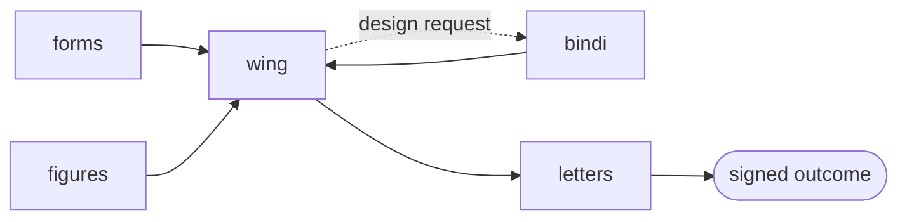

# FLEET — wetware-hq Synthetic Immunology Case Fleet

**System card · variant: agentic swarm/fleet**

A simulated hospital fleet that carries one patient case, end to end, from intake to a
signed outcome including a bespoke designed antibody. Synthetic-data-only, fail-closed,
not for real patients.

---

## Design principle

Refined for **minimum engineering idiot index, maximum clinical utility**: every repo that
was pure plumbing an orchestrator can absorb was demoted from a "stage" to **fabric**. What
remains as a node carries clinical signal; everything else is wiring.

- **Promoted to fabric (not stages):** `cards` (agent identity) and `orders` (task routing)
  become middleware the conductor owns, not steps a case passes through.
- **Folded into the design agent:** `seek` (sequence frame) is a library inside design, not a node.
- **Optional capability:** `synth` (codon → DNA) appears only when the case actually claims
  *synthesis*; `bloc` (biosecurity gate) re-enters the moment anything leaves simulation.

Net: a **5-agent clinical loop** on shared fabric, down from a 9-repo chain.

---

## The fleet (conductor + 4 clinical agents)

| Agent | Repo | Clinical job |
|---|---|---|
| **Conductor** | `wing` / `ward` | Orchestrates the swarm; owns identity + routing fabric |
| Intake | `forms` | Patient case in, questionnaire checkpoint |
| Evidence | `figures` | Data cleanroom → defines the target (neoantigen) |
| Design | `bindi` | Antibody/binder design (BoltzGen backend) |
| Scribe | `letters` | Traceable, signed clinical outcome out |

**Fabric (every agent, not a stage):** `cards` identity · `orders` routing.
**Optional capability:** `synth` (synthesis) · `bloc` (release gate) — on only when claimed.

---

## Case flow

`cards`/`orders` wrap every edge as fabric. The `wing → bindi` design-request edge is the
**one uncoded bridge** — the single piece still needed for a true end-to-end run.

---

## Interfaces
- **In:** patient case (via `forms`).
- **Out:** signed clinical letter + design spec (via `letters`).
- **Internal contract:** shared JSON frames (Seek frame, design spec) + `WARD_SIBLINGS_DIR`.

## Out of scope / limits
- No real synthesis or ordering path; the loop ends at specs, never a made molecule.
- Safety gate (`bloc`) omitted from the minimal loop — re-add before anything leaves simulation.
- Synthetic data only; fail-closed by default.

## Status
- **Ready:** intake, evidence, design, scribe, conductor.
- **Gap:** `wing → bindi` design-request bridge (uncoded).
