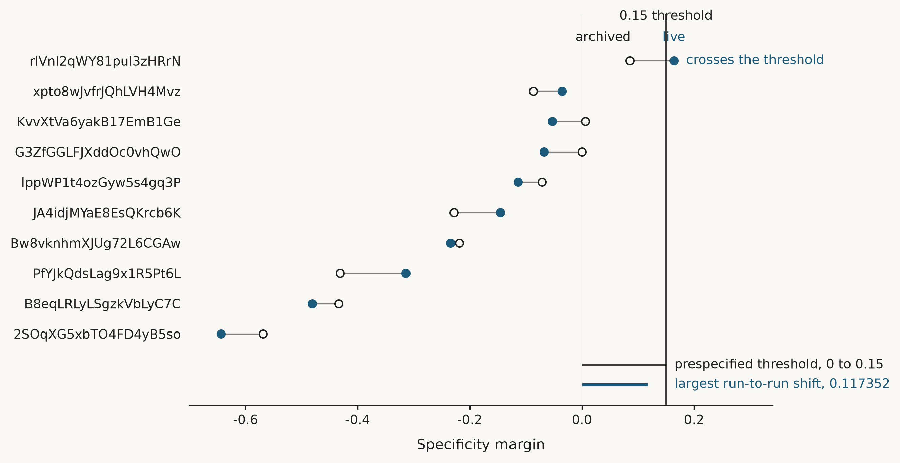

# Reproducibility of the specificity margin in the NY-ESO-1/HLA-A*02:01 binder campaign

**Date:** 24 October 2026

## Abstract

**Background.** Candidate selection in this campaign rests on the specificity margin, a quantity derived from structure prediction of each designed binder against its cognate peptide-HLA complex and against a panel of ten single- and multi-residue decoy peptides. Candidates are promoted only above a prespecified margin threshold of 0.15. The threshold has been applied to a single prediction per design-peptide pair, and the stability of that prediction had not been assessed.

**Methods.** All 100 design-decoy structure predictions were regenerated and rescored with inputs and analysis code held identical to the archived run: the same ten binder sequences, the same decoy panel, the same interface confidence metrics and the same scoring pipeline. The archived and live panels were then compared design by design, for the specificity margin, for the sequence-derived developability liability verdicts and for the gating outcome.

**Results.** None of the 100 predictions reproduced; every per-prediction metrics record differed from its archived counterpart. The resulting specificity margins differed with a mean absolute difference of 0.0637, a maximum of 0.1174 and a standard deviation of 0.0725, against a prespecified threshold of 0.15. The leading candidate moved from 0.085826 to 0.163938 and so crossed the threshold, changing the campaign result from 0 of 10 candidates above threshold to 1 of 10. Sequence-derived liability verdicts were unchanged in all ten candidates. No candidate was promoted in either run, because independent liability and unpinned-gate blocks held. Predictions were generated without a recorded random seed, and the declared content address names a seed that is never set, so the published manifest hash was identical across the two divergent runs.

**Conclusions.** Run-to-run variation in the specificity margin approaches the magnitude of the decision threshold itself. A single unseeded prediction therefore cannot support a fixed-threshold gate at this effect size, and near-threshold ranking should be treated as indeterminate rather than as a result.

## Figure

**Figure 1.** Specificity margin for each of the ten binder candidates (n = 10 designs, each scored against a panel of ten decoy peptides, 100 structure predictions per run) in two runs that used identical binder sequences, identical decoy panel and identical analysis code. Open circles denote the archived run, filled circles the live run, and the connecting rule the movement between them; the vertical line marks the prespecified threshold of 0.15, and the faint line marks zero. The two horizontal rules at the foot are drawn on the same scale as the data: the upper spans the full decision distance from 0 to the 0.15 threshold, the lower the largest observed run-to-run shift of 0.117352. The reader should take from the figure that the movement attributable to rerunning the prediction alone is of the same order as the distance the threshold is meant to discriminate, and that this is sufficient to carry the leading candidate, rIVnI2qWY81pul3zHRrN, from 0.085826 to 0.163938 and across the threshold.

## Open decisions

Three courses are available, and they are not mutually exclusive. The first is to pin and record a random seed for each prediction, which would make the declared content address and the manifest hash truthful; it would not make runs reproducible, and it would not make any single draw more trustworthy, since a seeded value remains one sample from the same distribution. Appendix 1 reports a direct test of this course. The second is to replicate each prediction and gate on a confidence interval rather than a point estimate, which addresses the dispersion directly but scales linearly in cost: three replicates of 100 predictions is approximately $15.00 at $0.05 per prediction, which exceeds the remaining approval cap, so a replicate design requires either a revised cap or a reduced panel. The third is to revisit whether a fixed threshold of 0.15 is defensible at all on a quantity whose run-to-run standard deviation is 0.0725, as against widening it into a band with an explicit indeterminate verdict or replacing it with a ranked comparison against the decoy panel that does not depend on an absolute cut.

## Appendix 1. Attribution of the variation to the random seed

**Question.** Whether the run-to-run dispersion reported above is attributable to sampling without a fixed random seed.

**Methods.** The leading candidate, rIVnI2qWY81pul3zHRrN, was studied, this being the design whose threshold crossing the dispersion decided. Its full ten-peptide decoy panel was predicted twice under an identical pinned random seed of 20261024 and identical sampler settings of 3 recycling steps, 200 sampling steps and a diffusion step scale of 1.638, giving 20 predictions. All other inputs were held as in the main comparison. Three controls establish that the pinned settings took effect rather than being ignored: the prediction service rejects unrecognised sampler options, every response returned the pinned settings as submitted, and the ten requests were identical between the two arms. Absent these controls, a negative result could not be distinguished from a seed that was never applied.

**Results.** Predictions were not identical under a pinned seed. Five of the ten structures reproduced exactly and five did not. The specificity margin was 0.150682 in the first arm and 0.150285 in the second, a difference of 0.000397, against 0.078112 between the two unseeded runs of the same design: approximately 197-fold narrower.

| Condition | Margin, run 1 | Margin, run 2 | Difference |
| --- | ---: | ---: | ---: |
| Pinned seed | 0.150682 | 0.150285 | 0.000397 |
| Unseeded | 0.085826 | 0.163938 | 0.078112 |

**The difference that remains is larger than the margin that is being read.** Both seeded arms clear the 0.15 threshold, by 0.000682 and 0.000285 respectively. The residual difference between them, 0.000397, exceeds the smaller of those two distances and is of the same order as the larger. A design that passes by less than the variation remaining after the seed is fixed has not been shown to pass.

Two further observations bear on interpretation. Neither seeded value reproduces either unseeded value; pinning the seed returned a third answer rather than one of the two already obtained. And the decoy peptide that set the margin differed between conditions, being decoy_p5_w_to_a when unseeded and decoy_p6a_p7a in both seeded arms. A design's measured specificity therefore depends in part on which decoy happens to score highest in the draw at hand.

**Limitation.** Two runs per condition demonstrate non-identity but cannot estimate a variance. The fold-differences above compare single observed spreads, not estimated variances, and should be read as indicative of magnitude only.

**Interpretation.** Pinning the seed is necessary and insufficient. It removes most of the dispersion without making any single prediction reproducible, and it does not render a threshold verdict trustworthy for a design lying this close to the line.
