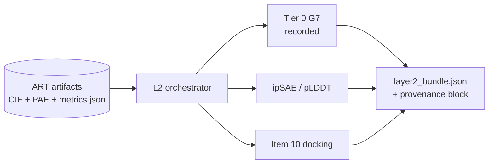

# UPGRADES — geometric heuristics for binder design

**Version:** 1.1 · **Date:** 2026-10-22 (Australia/Sydney)
**Scope:** the pre-experimental geometric layer only. No gate in `FLEET.toml` is changed by this
document. Anything this file proposes changing is marked as a proposal and needs the user's decision.

> This file is the *methods* half of the geometric layer. It does not duplicate the clinical case,
> the executable graph, the platform contract or the measured run-one analyses; it cites them by
> path. **Section 8 indexes the files these methods cite** — add a methods-cited file there and
> nowhere else. It is not the campaign manifest; `fleets/README.md` is.

## How to read this file

Section 2 is a **framework**, stated without loss of generality: a target body, a binder body, an
epitope patch, invariant versus discriminating surface. No named protein appears in it. Each
component is a block `G1`-`G7` with five fields:

- **Asserts** - what it claims, in sentences a reader can apply by hand with no code.
- **Provenance** - `CODE <file:line>`, `PAPER-ONLY`, or `OURS`.
- **Teacher's setting** - the value the source implementation used, as illustration only.
- **Principle** - why it works, independent of that setting.
- **Limits** - the conditions *on the target* under which it holds and fails.

Section 3 instantiates the framework on this campaign's target. **Section 2 does not depend on
section 3: delete section 3 and the framework still stands.**

Section 4 lists heuristics cheapest-discriminator-first. Each cites the component it derives from.
A heuristic citing no component is marked **ORPHAN**: it rests on something outside the distilled
model, which is a reason to distrust it, not a reason to drop it.

Section 10 is the **A2A coding handover** for implementing the layer-2 upgrade (refactor) on top of
sections 2–9. *(Former standalone `handover.md`, absorbed 2026-10-22.)*

## Sources, and their weight

| Source | Inspectable implementation | Weight |
|---|---|---|
| HECTOR - Maksymenko et al., Adv. Sci. 2025, `10.1002/advs.202502015` | Yes, Code Ocean capsule `10.24433/CO.9243108.v1` | Code authoritative; paper interprets variables only |
| BindCraft2 v1.0.4, PacesaLab | Yes, source clone | Code authoritative |
| Anthropic scorpion-toxin binder report | **No source released** | Prose only, **unverifiable**, lowest weight |

Where paper and code disagree the code wins and the disagreement is recorded here.

---

## 2. The framework (WLOG)

Two bodies. A **target body** carries a surface; a bounded patch of it is the **epitope patch** we
intend to engage. The remainder is **invariant surface** where it is shared with non-target bodies,
and **discriminating surface** where engaging it distinguishes this target from everything else. A
**binder body** carries its own surface, part of which becomes the paratope.

The framework's subject is which placements of the binder body against the target body are
geometrically admissible, and how cheaply that can be decided before any affinity claim is made.

### G1 - Surface patch representation

**Asserts.** A surface patch is represented from a single oriented point: a position on the
molecular surface plus its outward unit normal. Every other surface point inside a cylinder around
that normal is reduced to two numbers - signed distance *along* the normal, and perpendicular
distance *off* the normal axis - and accumulated into a 2D occupancy histogram. The angle *around*
the normal is never a coordinate; it is integrated out by construction.

**Provenance.** `CODE hector_mapper.py:130` (signed axial coordinate), `:136` (radial coordinate),
`:147-154` (2D binning, no azimuthal term), `:132,106,137` (cylinder acceptance test).

**Teacher's setting.** Cylinder radius 10 Å, axial half-height 10 Å, bin 0.2 Å, surface inflated
0.5 Å along the normal before mapping, map min-max normalised to [0,1], stored float16
(`CODE invoke_hector.sh:10`, `hector_mapper.py:241`, `:186-194`, `:249`).
The argparse defaults at `hector_mapper.py:313-320` are **dead code** — the arguments are
positional-required at `:312-321` — so the authoritative values are the invocation-line ones above.
Recorded because a reader who takes those defaults as live runs a different algorithm.

**Principle.** For the purpose of deciding *fit*, a patch's identity is its depth profile as a
function of radius. Collapsing three dimensions to two turns comparison into a cheap image
operation instead of a geometric search, and makes the descriptor invariant to rotation about the
normal, so two patches can be compared without first being aligned. That invariance is the whole
source of the speed.

**Limits.** Holds for patches approximately radially symmetric about the normal: a dome, a bowl, a
flat face. **Fails for anisotropic patches** - a channel, a cleft, a groove with two near-parallel
walls - because the directionality distinguishing a channel from a symmetric pit of identical
radial profile is exactly what azimuthal integration discards. Separately, the cylinder radius
*defines* what counts as the patch: when the intended epitope patch is smaller than the cylinder
and is flanked by taller surface, most accumulated surface is the flank, so the descriptor
describes the flank. Where the flank is invariant surface, **the representation is systematically
biased toward invariant engagement**, which is the failure mode this campaign most needs to avoid.

### G2 - The two-body relation

**Asserts.** Both bodies are held **rigid**. The only degrees of freedom are the six of relative
rigid-body placement, and they are not searched continuously: a placement is *constructed* by
superposing a small set of corresponding anchor points, then accepted or rejected. No conformational
change, no side-chain repacking, no induced fit.

**Provenance.** `CODE aln_fltr_4_dots.py:230-291` (placement by 4-point anchor), `:97-147`
(Kabsch superposition), `:260,280` (anchor-fit RMSD acceptance).

**Teacher's setting.** Four anchor points - two patch pairs, two points each - with an accepted
anchor-fit RMSD of ≤ 0.5 Å (`CODE aln_fltr_4_dots.py:317`).

**Principle.** If a pairing hypothesis is right, the placement it implies is already determined;
there is nothing left to search. Constructing the pose from correspondences and testing it is
strictly cheaper than optimising over six degrees of freedom, and it fails fast: a wrong hypothesis
produces an anchor fit that cannot be made consistent.

**Limits.** Rigidity is an assumption about the *target*, not a convenience. It holds for a target
whose epitope is structurally constrained and does not rearrange on binding, and fails where the
epitope is flexible, where binding is known to induce fit, or where the coordinates are a prediction
whose local geometry is uncertain at the scale of the acceptance tolerance. A 0.5 Å anchor tolerance
is a statement about crystallographic coordinates; it does not transfer to predicted coordinates at
that value.

### G3 - The complementarity measure

**Asserts.** Complementarity is not computed as an energy. One patch's map is **inverted in
polarity** and compared against the other's as an image; a high image similarity *is* the claim that
the two surfaces are shape-complementary. The measure is a single-term structural similarity over
the two normalised maps, pixel by pixel, with no windowing and no variance term.

**Provenance.** `CODE sim.pyx:13,19,26,28` (the similarity itself:
`S = (2*a*b + C1) / (a^2 + b^2 + C1)`, meaned over pixels, `K1=0.01`, `data_range=1`, so
`C1 = 1e-4`); `CODE maps_analysis_pairs_vs_all.py:48` (R-factor `= -1 × SSIM`, so *lower is
better*); polarity inversion at `CODE hector_mapper.py:217` and
`maps_analysis_pairs_vs_all.py:8-18`.

**Teacher's setting.** Mean R-factor ≤ -0.82, i.e. mean similarity ≥ 0.82
(`CODE invoke_hector.sh:18`, applied at `maps_analysis_pairs_vs_all.py:134`).

**Principle.** A protrusion and the recession that accepts it are the *same* depth profile with the
sign of the axial coordinate flipped. Once that is true, "do these two surfaces fit" becomes "are
these two images the same", and the answer costs one array comparison rather than a physics
calculation. This is the single cheapest honest statement of complementarity available.

**Limits.** **This is a similarity statistic, not an affinity statistic.** No part of it is fitted or
calibrated against binding; the cutoff is a similarity threshold. It is also blind to everything
except shape: charge, polarity, hydrogen-bonding geometry and desolvation are absent. It therefore
rejects impossible fits well and asserts nothing about good ones.

**Correction to our own earlier framing.** This is **not** Lawrence-Colman shape complementarity
(`Sc`). Both are "shape complementarity" in spirit; they are different statistics computed
differently. Earlier campaign discussion that called them the same quantity was wrong. The
epistemic distinction in G5 stands regardless.

### G4 - The pair restraint

**Asserts.** The unit of evidence is not a patch but a **pair of patches at a known separation**. A
candidate must match two query patches *and* reproduce the distance between them to within a tight
tolerance. The restraint is what converts a soft similarity score into a near-rigid geometric
hypothesis.

**Provenance.** `CODE maps_analysis_pairs_vs_all.py:207-209` (three query points),
`:211-213` (three pairs), `:71-72,118` (inter-patch distance test), `:215` (per-patch shortlist),
`:134` (mean-similarity cutoff).

**Teacher's setting.** Keep the top 5% of candidate patches by similarity per query patch, then
require the candidate pair's internal separation to match the query's to within ±0.01 Å.

**Principle.** Two independently good patch matches are cheap coincidence; a surface database will
always supply them. Two good matches *at the correct separation* are not, because the constraint is
multiplicative and the tolerance is far tighter than the shape-matching tolerance. A pair carries
orientational information that no single patch does, and it also determines the placement outright,
which is what G2 then consumes.

**Limits.** The tolerance is only meaningful if the separation is itself trustworthy, so this is a
statement about **rigid, experimentally determined coordinates**. On predicted coordinates, or on a
flexible epitope, a 0.01 Å restraint is not a strong filter but an arbitrary one. The principle
transfers to any target; **the setting does not**.

### G5 - Retrieval and ranking, and when a score is earned

**Asserts.** Candidates are **retrieved** from a library of existing bodies and then **filtered** by
hard geometric criteria that each must pass. Nothing is ranked by predicted affinity, because no
affinity model is present. The only continuous quantity surfaced is the shape-similarity score from
G3. Admissibility is a conjunction of pass/fail tests, not a weighted sum.

**Provenance.** `CODE aln_fltr_4_dots.py:278-280` (all three filters must pass),
`:279` (interface residue count ≥ 25, interface defined as target Cα within 11.0 Å of a candidate Cα,
`:202`), `:278` with `:315` (solvent-mask steric overlap ≤ 125000, computed at `:205-227`),
`:317` (anchor RMSD ≤ 0.5 Å), `:312-313` (support distance 22, solvent kernels at 0.50 Å / 24 voxels).
Downstream interface design and molecular-dynamics scoring are **PAPER-ONLY**, outside the capsule,
and source no number here.

**Teacher's setting.** The three values above, over a library of X-ray structures better than 2.0 Å
resolution (`PAPER-ONLY`).

**Principle.** Two things. First, **hard conjunctive filters beat a composite score** when no term
is calibrated: a weighted sum lets a good shape score pay for a steric clash, and a conjunction
cannot. Second, and more important, **where the geometry is computed decides what the claim is
worth**. Retrieval runs over bodies whose coordinates were measured, before any design or
prediction exists. A geometric claim made there is independent evidence. The same statistic computed
*after* prediction, on coordinates the designer itself produced, inherits the designer's error and
largely restates the designer's own confidence. Same arithmetic, different epistemic status.

**Limits.** Retrieval can only return what the library contains, so coverage is a hard ceiling and
an unrepresented shape class is simply unreachable. The hard filters are necessary conditions, never
sufficient ones: passing all of them means "not excluded", which is weaker than it reads.

### G6 - What the projection discards

**Asserts.** The representation in G1 is lossy, and the losses are specific and knowable: the
azimuthal direction around the normal, everything outside the support cylinder, everything finer
than the bin width, and all chemistry. A heuristic resting on G1 can make no claim that depends on
a discarded quantity.

**Provenance.** `OURS`, derived from `CODE hector_mapper.py:147-154` (no azimuthal coordinate),
`:132,137` (cylinder truncation), `:104-105` (bin quantisation).

**Teacher's setting.** Not applicable; this component is a property of the representation rather
than a parameter.

**Principle.** Stating a descriptor's null space is what makes it safe to use. A descriptor is
trustworthy exactly to the extent that the question being asked of it lives outside its null space,
and asking a question inside the null space returns a confident answer that means nothing.

**Limits.** This component has no failure mode of its own; it is the audit applied to the others. Any
new heuristic proposed for this stack must state which of these four losses it depends on, or
declare that it depends on none.

### G7 - Targeting as a computed quantity

**Asserts.** "On-epitope" and "off-epitope" are not impressions; they are fractions computed from
residue flags. Three flag classes are carried on the target body: **hotspot** residues the binder is
required to touch, **coldspot** residues it is required to avoid, and an **epitope shell** derived
automatically as every target residue within a cutoff distance of any hotspot atom. Contact is then
a heavy-atom distance test, and each targeting quantity is a ratio of contacted residues.

**Provenance.** `CODE bindcraft/epitope_targeting.py:25-29` (epitope shell as minimum atom-atom
distance to any hotspot atom, `:7` `EPITOPE_CUTOFF = 10.0`);
`CODE bindcraft/filters.py:423-432` (`Off_Epitope_Contact_Fraction` = contacted target residues
*outside* the shell, over all contacted target residues);
`:209-217` (`Hotspot_Contact_Fraction` = contacted hotspots over all hotspots);
`:219-227` (`Coldspot_Contact_Fraction` = contacted coldspots over all coldspots);
`:200-207` (`Off_Paratope_Contact_Fraction`, the same idea applied to the binder's own surface).
Contact cutoff is 4.0 Å heavy-atom in all four (`CODE filters.py:210,220,424`).
All four are registered as lower-is-better except the hotspot fraction
(`CODE bindcraft/rank.py:18-24`).

**Teacher's setting.** Epitope shell 10.0 Å; coldspot contact ≤ 0.05;
off-paratope contact ≤ 0.2 (`CODE bindcraft/settings.py:196,215`).
**Recorded honestly:** `max_off_epitope_contact_final` and `min_hotspot_contact_final` are
recognised settings with **no default value** - verified absent from the `setdefault` block - so the
off-epitope and hotspot gates are opt-in per campaign. The teacher supplies the *metric*, not a
calibrated threshold.

**Principle.** Once off-target engagement is a number, it can be gated, ranked and pre-registered
instead of argued about after the fact. The deeper move is that the shell is derived from the
hotspots rather than declared separately, so a single statement of intent - these residues matter -
generates both the positive and the negative criterion, and they cannot drift apart.

**Limits.** The fractions are only as good as the flags: mis-assigned hotspots produce a confident
number measuring the wrong thing. The shell cutoff is a free parameter with no calibration behind
it, and at 10 Å on a small target a shell can swallow most of the surface, making "off-epitope"
vacuous. Nothing here says a contact is *favourable*; it says only where contact fell. Finally this
component requires a predicted or measured complex to measure at all, so unlike G1-G4 it cannot
screen candidates before a structure exists.

### The general hazard

Where the **discriminating surface is a small subset of a large invariant surface**, the two-body
framework has a structural failure mode that no amount of scoring removes: a design can achieve a
large, well-packed, confidently-predicted interface while drawing most of its interaction energy
from the invariant part. Every geometric measure in G1-G5 will read as success, because the
geometry *is* successful; it is successful against the wrong surface. G7 is the only component that
can see this, and only after a structure exists.

The corollary is uncomfortable and should be stated plainly: **on this class of target, high
interface confidence is not evidence of a good binder and may be evidence of a bad one.** A
clinically useful binder here must be *selective*, and selectivity is a statement about a
*difference* between surfaces, which no single-complex score can express.

---

## 3. Instantiation — NY-ESO-1 157-165 / HLA-A\*02:01

The clinical case is `CASE.md`; the measured contacts are `run-one/CONTACTS.md`. (Section 2 does
not depend on this section — said once under "How to read this file".)

### Binding the general terms

| Framework term | This campaign |
|---|---|
| Target body | the 3-chain class I pMHC assembly: heavy chain (chain A, 275 res), beta-2-microglobulin (chain B, 99 res), peptide (chain C, `SLLMWITQC`, 9 res) |
| Binder body | chain D, 73 aa in run one |
| Epitope patch | the solvent-exposed face of the bound peptide — positions P4-P8, with P5 a tryptophan |
| Invariant surface | the heavy chain and beta-2-microglobulin, present on every nucleated cell at several hundred thousand copies |
| Discriminating surface | the exposed peptide face only |
| Buried, unavailable | P2 and P9, the anchor positions held in the groove |

The ratio is the whole problem: a few hundred Ų of discriminating surface against roughly
30,000 Ų of invariant surface on the same body.

### Applicability, derived from the limits fields

| Component | Verdict | Reason, from the limits field |
|---|---|---|
| **G1** patch representation | **INAPPLICABLE** | The class I groove is an anisotropic two-walled channel open at both ends. G1 integrates out the azimuthal direction, so it cannot distinguish that channel from a radially symmetric pit of the same depth profile. Compounding it, a 10 Å support cylinder centred on the shallow peptide strip is filled mainly by the α1 and α2 helical walls — invariant surface — so the descriptor would describe the walls. No validated HECTOR target was a recessed groove; every one was a convex epitope matched to a concave scaffold. |
| **G2** two-body relation | **APPLICABLE WITH MODIFICATION** | The pMHC groove is genuinely rigid, which is the condition G2 needs, and the peptide is held by its anchors. But our coordinates are *predicted*, so the 0.5 Å anchor tolerance is not transferable; any use of G2 here must re-derive its tolerance against prediction error. |
| **G3** complementarity measure | **INAPPLICABLE AS INHERITED** | G3 consumes G1's maps, so it fails with G1. Separately we already rejected post-hoc Lawrence-Colman `Sc` on predicted coordinates for an independent reason (section 5). |
| **G4** pair restraint | **PRINCIPLE APPLICABLE, SETTING NOT** | A pair of anchor points at a known separation is a strong hypothesis on any target. The ±0.01 Å tolerance is meaningful only on crystallographic coordinates and must not be carried over. |
| **G5** retrieval and ranking | **PARTLY APPLICABLE** | Hard conjunctive filtering transfers directly and we should adopt it. Retrieval over a fingerprinted structure library does not, because it depends on G1. The epistemic point — that geometry computed before prediction is independent evidence — is the most valuable thing in the whole framework for us, and we currently satisfy none of it. |
| **G6** projection losses | **APPLICABLE** | It is an audit, not a method. It applies to every heuristic we adopt. |
| **G7** targeting as computed quantity | **APPLICABLE NOW, ZERO SPEND** | Contact masks already exist from run one. Flagging chain C P4-P8 as hotspot and the α1/α2 rims, α3 and chain B as coldspot makes off-epitope and coldspot engagement computable today from artifacts on disk. The "α1/α2 rims" have no residue list: `targeting_flags.json` derives them as helix-minus-shell, so they move with the shell cutoff (F4/P4). |

The G1 verdict is the load-bearing one and it propagates: G3 fails because it consumes G1's output,
and HECTOR's retrieval step fails with it. What survives from HECTOR is G2, G4's principle, G5's
filtering discipline and G5's epistemic ordering — not its descriptor.

### The general hazard, instantiated

The hazard in section 2 is not hypothetical on this target class. The MAGE-A3 a3a affinity-enhanced
TCR engaged an unrelated titin peptide presented by the same HLA-A\*02:01 and killed patients. That
is the proving instance: a reagent optimised for affinity against a pMHC target, with cross-reactive
engagement that no single-complex confidence score would have flagged. This record is retained
deliberately and is not to be removed from this document or from `CASE.md`.

### What run one does and does not establish

Recorded once, in `run-one/CONTACTS.md` under "How much of that is our own specification returned
to us", which carries the numbers, the per-design tables and the independent reproduction of the
anchor result. That reading was adopted there on 2026-10-22; this file does not restate it.

What section 4 and section 6 below depend on, and nothing more:

- The peptide-directed footprint is **substantially our own specification returned to us** — the
  submitted request named all nine peptide residues — so it is **not** independent evidence of
  selectivity, and must not be scored as such.
- The **zero buried-anchor contacts** and the **1.3-5.5% heavy-chain surface use** were not
  specified by us and do carry information. Item 4's `OURS, measured 1.3-5.5%` provenance is that
  second number.

**No measurement is to be deleted** — only the interpretation around it.

---

## 4. The heuristics, cheapest discriminator first

Status is one of **GATING** (a pass/fail condition), **RECORDED-NON-GATING** (measured and stored,
never used to pass or fail a design), or **REJECTED**. `Cites` is the framework component a
heuristic derives from; **ORPHAN** means it rests on something outside the distilled model.

Nothing in this table changes `FLEET.toml` (section 5, last two entries). Items marked *proposed*
need the user's decision.

The Tier 0 items were written before they were run; section 9 holds the measured values and the
proposals arising. **Two of those proposals are reflected in the Status column below — P1 (item 1's
shell) and P2 (item 3 as a pass/fail) — and nothing else is.** Every remaining proposal stays
*proposed* and reserved for the user.

### Tier 0 — computable today, zero spend, from artifacts already on disk

| # | Heuristic | Source | Provenance | Cutoff | Evidence of | NOT evidence of | Status | Cites |
|---|---|---|---|---|---|---|---|---|
| 1 | **Off-epitope contact fraction** — contacted target residues outside the hotspot-derived shell, over all contacted target residues | BindCraft2 | `CODE filters.py:423-432`, `epitope_targeting.py:25-29` | shell **5.0 Å** (P1, on the structural argument in section 9, *not* on the sweep's spread), contact 4.0 Å; **no default threshold in code** — ours to set and pre-register | where contact actually fell | that on-epitope contact is favourable | **RECORDED-NON-GATING through run two** (P1; vacuous at the inherited 10 Å — F1) | G7 |
| 2 | **Coldspot contact fraction** — contacted residues among those explicitly flagged to avoid | BindCraft2 | `CODE filters.py:219-227`, default `CODE settings.py:196` | teacher's ≤ 0.05; ours to re-derive, not inherit | engagement of surface we declared off-limits | affinity, or the absence of it | **GATING, proposed** | G7 |
| 3 | **Buried-anchor contact count** — contacts to anchor positions held inside the groove | ours | `OURS` | **exactly 0**; any non-zero fails. Needs no calibration: zero is forced by the geometry, not transferred | a physically impossible or mis-modelled pose | selectivity | **GATING, pass/fail at exactly zero** (P2, F2). Recorded here only — the `FLEET.toml` descriptors stay `iptm` and `plddt` | G7, G6 |
| 4 | **Invariant-surface fraction** — fraction of the invariant surface the binder buries | ours (run one) | `OURS`, measured 1.3-5.5% | ours to pre-register before the next run | framework engagement, the hazard in section 2 | peptide specificity | **RECORDED-NON-GATING** | G7 |
| 5 | **Hard conjunctive filtering** — every geometric criterion must pass on its own; no weighted composite | HECTOR | `CODE aln_fltr_4_dots.py:278-280` | not a cutoff, a combination rule | nothing by itself | nothing by itself | **GATING, proposed** (as policy) | G5 |
| 6 | **Steric admissibility** — interface residue count and a clash ceiling as independent hard tests | HECTOR | `CODE aln_fltr_4_dots.py:279` (≥ 25 interface residues), `:278,315` (overlap ≤ 125000) | teacher's values are library- and mask-specific; **do not transfer the numbers** | that a pose is not excluded | that a pose is good | **RECORDED-NON-GATING** | G5, G2 |

### Tier 1 — cheap CPU, our own code, no new infrastructure

| # | Heuristic | Source | Provenance | Cutoff | Evidence of | NOT evidence of | Status | Cites |
|---|---|---|---|---|---|---|---|---|
| 7 | **Decoy margin, not absolute score** — select on the distance between a design's score and a decoy distribution, never on the score itself | Anthropic | `PAPER-ONLY`, **unverifiable** | 95th percentile of 28-31 decoys, floor 0.15, **pre-registered before scoring** | relative discriminability within a comparison set | an absolute quality or an affinity | **GATING, proposed** | ORPHAN — it is a *selection* policy, outside the geometric model |
| 8 | **Selectivity as a difference** — score the designed complex against a matched invariant-only or irrelevant-peptide complex and take the difference | ours | `OURS` | ours to pre-register | a *difference* between surfaces, which is what selectivity means | affinity | **GATING, proposed** | G7, general hazard |
| 9 | **Pair-of-anchors geometric hypothesis** — require two correspondences at a reproduced separation rather than one good patch | HECTOR | `CODE maps_analysis_pairs_vs_all.py:71-72,118,211-213` | principle only; **the ±0.01 Å setting does not transfer to predicted coordinates** | a near-rigid placement hypothesis | affinity | **RECORDED-NON-GATING** | G4, G2 |

### Tier 2 — new CPU work on the existing Modal layer 2, bounded spend

| # | Heuristic | Source | Provenance | Cutoff | Evidence of | NOT evidence of | Status | Cites |
|---|---|---|---|---|---|---|---|---|
| 10 | **Independent pose re-derivation by classical rigid-body docking** — re-derive the pose with a scorer that shares no parameters with the designer, then compare. Both read-outs are *comparisons*: pose agreement, and the **change** in complementarity between the designed and re-derived pose | ours | `OURS` | ours to pre-register; report pose agreement and the complementarity *change*, never a docking score or an absolute complementarity | a placement independently supported by physics; self-consistency of the interface geometry | binding affinity (docking scores are not affinities); shape complementarity in the HECTOR sense | **GATING, proposed** (the complementarity change within it stays **RECORDED-NON-GATING**) | G5 (the epistemic ordering), G2, G3 |

Item 10 is the single most valuable upgrade available to us and it is permitted: classical
rigid-body docking is CPU-only and is not a published neural model, so it respects the standing rule
that published models stay on their hosted API and only our own CPU scorers are self-hosted. It runs
on the layer-2 path that is already sized and live. It is also *better* orthogonality than
Anthropic's own self-consistency check, which they concede is partly circular.

### Redundancy, named

- **Items 1 and 2 versus HECTOR's interface-residue count (item 6).** Both measure where contact
  fell. **Keep 1 and 2**, because they are *directional* — they distinguish wanted from unwanted
  surface — while a bare interface count cannot. Item 6 is retained as a recorded sanity check only.
- **Item 7 versus item 8.** Both answer "compared with what?". They are not redundant: 7 compares a
  design against *other designs and decoys*, 8 compares a design against *a different target
  surface*. We need both, and 8 is the one that speaks to clinical selectivity.
- **The complementarity change (inside item 10) versus our earlier `Sc` work.** Same family of
  quantity, different use: read as a *change* between two independently derived poses, never as an
  absolute score on the designer's own coordinates (section 5). It was carried as a separate item 11
  and is now folded into item 10, which is the only thing that can produce it; the measurement and
  its non-gating status are unchanged.

---

## 5. Rejected, with reasons

**Post-hoc Lawrence-Colman shape complementarity (`Sc`) as a filter on predicted coordinates.**
Rejected. Computed on our run-one designs it correlates with the predictor's own confidence at
Spearman 0.673 against `iptm` and 0.685 against ipSAE (n = 10), so as a gate it would largely
re-impose the predictor's opinion under a different name, while additionally inheriting side-chain
prediction error. The measurement is kept and the gate is not: it stays **RECORDED-NON-GATING**, and
the Spearman values above are its entire committed record — **no results file was ever committed**,
so there is no `sc_results.json` or other path to cite and the per-design values are not in this
repository (section 8). *This is not a rejection of complementarity as such* — see the next entry.

**The apparent contradiction with HECTOR, resolved.** HECTOR puts surface complementarity at the
*centre* of its method and succeeds; we rejected it. Both are correct, because they are not the same
move. HECTOR computes complementarity as the **primary retrieval criterion over bodies whose
coordinates were experimentally determined, before any design or prediction exists** (G5). We were
computing it **after** prediction, on coordinates the designer produced. The arithmetic is similar;
the epistemic status is not. The two are not even the same statistic — see G3's correction.

**HECTOR's fingerprint retrieval on this target.** Rejected on the G1 limits, not on quality: the
descriptor cannot represent a walled groove, and its support cylinder would describe the invariant
helical walls rather than the peptide. This is the most expensive capability in either source
repository and it is the one we cannot use.

**Any affinity interpretation of a HECTOR-style score.** Rejected. There is no KD variable anywhere
in the capsule and no cutoff is fitted against measured affinity; the published evidence is that
roughly 24 candidates were characterised and nanomolar binders were found. The -0.82 is a similarity
threshold. Treating it as an affinity threshold would be a category error.

**Promoting any of this to a `FLEET.toml` gate without calibration.** Rejected for now. The gating
descriptors remain `iptm` and `plddt` only; `ipsae` and `min_ipsae` remain recorded and non-gating.
Every threshold inherited from a source repository is **transferred, not calibrated for this system**,
and that caveat travels with every number in section 4. We also still hold **no independent model**
of this interface — item 10 is the proposal that would change that, and until it runs the caveat
stands.

**Weakening any safety invariant to make room for the above.** Out of scope and refused. The
in-graph APPR human gate, `spend_cap_usd = 15.00` and `on_deny = "HALT"` are untouched by this
document, as is the OD-8 digest resolution.

---

## 6. Pre-registered prediction

Fixed **before** any decoy or selectivity scoring runs, so that it can be wrong.

> **The designs that look highest-affinity will be the least selective.**

The reasoning is physical, not statistical. High-affinity protein interfaces typically bury
1,500-2,000 Ų. The discriminating surface available on this target is a few hundred Ų. A design
that achieves a high-affinity-looking interface therefore cannot be getting it from the
discriminating surface alone; the remainder must come from the invariant surface. Natural T-cell
receptors against pMHC sit at micromolar affinities and recover function through avidity, clustering
and co-receptor engagement rather than through tighter single-site binding — strong evidence that
evolution declined to build what a naive affinity objective asks for here.

Operationally: expect the rank order by `iptm` to **anti-correlate**, or at best not correlate, with
rank order by invariant-surface fraction (item 4) and by the selectivity difference (item 8). On this
target class **high interface confidence is a warning sign, not a success criterion.**

Falsification: if high-`iptm` designs show *low* invariant-surface use and *high* selectivity
difference, this prediction is wrong and the affinity-selectivity tension argued in section 2 does
not bind on this target. That outcome would be good news and should be reported as such.

---

## 7. What is not established

Named rather than papered over.

- **No calibrated threshold exists for any item in section 4.** Every cutoff is either the teacher's
  own setting, explicitly non-transferable, or ours still to pre-register.
- **No affinity model, and no measured affinity**, anywhere in this stack or in either source
  repository.
- **No experimental validation of any geometric criterion on a recessed-groove epitope** exists in
  the literature surveyed; HECTOR's validated targets were all convex.
- **Anthropic's numbers cannot be verified**: no source was released. Their own report is the
  strongest evidence against over-trusting composite scores — all 60 single-toxin designs scored
  0.88-0.95, including the 12 against Ts1 that produced no binders at all — and that evidence is
  itself unverifiable.
- **The decoy construction for item 7 is not specified here.** What counts as a decoy for a pMHC
  target is a real design decision and is not settled by either source.
- **Item 10's cost is not yet measured**, only argued to be small.

## 8. Related files

**Scope: the files these methods cite**, and nothing else. Every other document in this directory
cites this section rather than repeating a list of its own. It is deliberately *not* the campaign
manifest: `infra.json`, `modal_layer2_app.py`, `run-one/layer2_eval.py`, `run-one/request.json`,
`run-one/request-legacy-submitted.json` and `run-one/artifacts/` exist in this directory, are cited
by no method here, and are catalogued in `fleets/README.md`. Absence from this list is not absence
from the repository — the one genuine non-existence is recorded under "Not committed" below.

**Documents**

- `CASE.md` — the clinical case and target selection.
- `FLEET.toml` — the execution graph, gates, thresholds and spend state (single source of truth).
- `PLATFORM.md` — the platform contract.
- `recommendations.md` — advisory scope, in-silico assay ladder, fleet hygiene (does not change gates).
- *(was `handover.md`)* — absorbed into **section 10** on 2026-10-22.
- *(was `REFINEMENTS.md`)* — absorbed into section 9 on 2026-10-22. Proposals P1-P4
  remain open there; the file itself is gone.
- `../../prior-art.md` (`fleets/prior-art.md`) — prior art for the `.fleet` specification
  format. Lives at the fleets/ level because it is about the format, not this campaign.
- `arch.mermaid` — the graph rendered.
- `run-one/CONTACTS.md` — the measured run-one contact analysis.

**Tier 0 code and artifacts** (section 4, Tier 0; measured in section 9)

- `run-one/tier0_targeting.py` → `run-one/tier0_targeting_results.json` — the four Tier 0
  quantities on the run-one coordinates, under BindCraft2's G7 definitions.
- `run-one/tier0_targeting.py sweep` → `run-one/shell_sweep_results.json` — item 1 across shell cutoffs.
- `run-one/contact_analysis.py` → `run-one/contact_analysis_results.json` — the campaign-specific
  contact rule behind `run-one/CONTACTS.md`.
- `targeting_flags.json` — the epitope, coldspot, anchor and invariant residue flags the above read.

**Not committed**

- The `Sc` measurements of section 5 have **no results file in this repository** — none in the
  working tree and none anywhere in git history. Their committed record is the Spearman values
  stated in section 5; the per-design values were never committed. Earlier revisions of this index
  cited `run-one/sc_results.json`, which has never existed — **do not cite that path.**

---

## 9. What the Tier 0 measurements changed

Absorbed from the former `REFINEMENTS.md` on 2026-10-22 (file deleted; content kept).
**Status:** findings and proposals. **No gate in `FLEET.toml` is changed by this section** — see the
unchanged-invariants note at the end.

Sections 2-4 were written before the Tier 0 items had been run. This section records what happened
when they were run on the ten run-one designs. It adds no measurement to `CONTACTS.md` and removes
none; code and artifact paths are indexed in section 8. **P1, P2 and P4's descriptive half are now
reflected in section 4 and in the prose below. P3, P4's residue list, and items 5, 7, 8 and 10
remain the user's to decide.**

---

### F1 - Item 1 is vacuous at the 10 A shell, as G7 predicted

Off-epitope contact fraction across all ten designs at the inherited 10.0 A shell:
**0.000 to 0.111, median 0.025, five designs at exactly zero**. The shell holds 66-73
target residues, 57-64 of them on chain A - most of the groove floor and both helices.

That is not a good score, it is a non-measurement. A binder sitting anywhere on the peptide
strip scores as fully on-epitope by construction, and one drifting onto the helices would
score the same. G7 Limits called it in advance: "at 10 A on a small target a shell can
swallow most of the surface, making off-epitope vacuous". It is now measured, not feared.

**A threshold cannot be pre-registered on a statistic with no spread.** Item 1 cannot become
a gate at 10 A whatever value is chosen.

#### The sweep

`run-one/tier0_targeting.py sweep` asks only the prior question: is there a cutoff at which item 1
discriminates at all?

| shell A | median | range | sd | designs at 0 | shell size |
|---|---|---|---|---|---|
| 4.0 | 0.458 | 0.125-0.611 | 0.132 | 0 | 16-21 |
| 5.0 | 0.316 | 0.125-0.474 | 0.093 | 0 | 21-23 |
| 6.0 | 0.257 | 0.000-0.421 | 0.109 | 1 | 27-32 |
| 7.0 | 0.194 | 0.000-0.278 | 0.081 | 1 | 35-43 |
| 8.0 | 0.065 | 0.000-0.167 | 0.059 | 3 | 46-53 |
| 10.0 | 0.025 | 0.000-0.111 | 0.037 | 5 | 66-73 |
| 12.0 | 0.000 | 0.000-0.111 | 0.037 | 6 | 86-91 |

Spread collapses monotonically as the shell widens. Discrimination survives at 4-6 A and is
effectively gone by 8 A.

#### Proposal P1, and the trap inside it

**P1, applied in section 4:** item 1 is re-registered at a **5.0 A** shell, RECORDED-NON-GATING
through run two. Consider gating only once a second run exists to calibrate against.
`targeting_flags.json` still carries `epitope_shell_cutoff_angstrom: 10.0` as the input to its
derived coldspot set; moving it there would also move that set (F4), so it is left for the owner.

**The structural argument, which is what must carry it.** 5.0 A is about one contact shell
beyond the hotspot atoms. It admits the groove rim a binder must touch to reach the peptide
and excludes the helix flanks it need not touch, so the quantity measures what its name
claims. At 10 A the name no longer matches the quantity.

**The trap.** The sweep must NOT be read as "pick the cutoff with the most spread". That
fits a free parameter to this campaign own ten designs, which is the circularity
section 5 rejects for Sc. The sweep establishes only that 10 A cannot work and
that a usable range exists. The 5.0 A choice stands or falls on the structural argument
above; the sweep merely shows it is not vacuous.

---

### F2 - Item 3 holds, and it is the signal that carries information

Zero buried-anchor contacts in all ten designs, reproduced independently of
`contact_analysis.py` by the G7 code path. Coldspot contact is ~0 throughout: one residue in
two designs, 0.005 of the declared coldspot set.

This matters because of what run one did and did not constrain (section 3, "What run one does and
does not establish"): the peptide-directed footprint is substantially our own specification
returned to us, while the anchor result was never specified and is real geometry. **Item 3 is the
one Tier 0 quantity whose run-one value is independent evidence**, and it is also the cheapest. It
is gated first, not last.

**P2, applied in section 4:** item 3 is recorded as a GATING pass/fail at exactly zero, since any
non-zero value is a mis-modelled pose rather than a weak design. It is the only Tier 0 item whose
threshold needs no calibration - zero is forced by the geometry, not transferred from a teacher.
The status lives in section 4 only; the `FLEET.toml` gating descriptors stay `iptm` and `plddt`.

---

### F3 - Section 6 contradicts itself, and the data lands on the seam

Measured Spearman for `iptm` against invariant-surface fraction (item 4) is **+0.636**
(n = 10; **+0.500** excluding the `pres_xpto8wJvfrJQhLVH4Mvz` outlier). Positive: higher
interface confidence goes with MORE invariant-surface burial.

Section 6 states two things that cannot both hold:

- Its **falsification criterion** says the prediction is wrong if high-`iptm` designs show
  *low* invariant-surface use. Under that reading +0.636 leaves the prediction standing.
- Its **operational line** says to expect `iptm` rank order to *anti-correlate* with item 4.
  Under that reading +0.636 contradicts it.

Item 4 is a lower-is-better quantity, so "high affinity, less selective" implies a POSITIVE
`iptm`-to-item-4 correlation. The falsification criterion is consistent with the physical
argument in section 6 and with section 2; the operational line appears to be the slip.

**Proposed P3:** correct the operational line in section 6 to expect positive
correlation with item 4, keeping the anti-correlation expectation for item 8 where it does
apply. **Owner decision - the prediction is pre-registered and only the user may restate it.**
Until it is restated, nothing should be scored against section 6.

Caveats that travel with the +0.636: n = 10, predicted coordinates, one campaign, and item 8
is not computed, so the affinity-selectivity tension itself remains untested.

---

### F4 - The coldspot rim is still undefined

Section 3 names "the alpha1/alpha2 rims" as coldspot, and no rim residue list is defined anywhere
in the repository. **What is actually implemented, stated plainly:** `targeting_flags.json` derives
the rim as *helix-minus-shell* - its `A_helix_ranges_minus_shell` spans 57-84 and 138-180, less
whatever the hotspot-derived epitope shell covers - so the coldspot set depends on the shell cutoff,
and P1's 5.0 A would move it. That derivation is the operative definition until the owner replaces
it, and it is now stated as such in section 3 and in `targeting_flags.json`'s own
`_coldspot_ambiguity` note, which already records the choice as unresolved.

**P4, descriptive half applied, decision still open.** The explicit rim residue list from the
published TCR-footprint literature - which would be cutoff-independent and would stop items 1 and 2
sharing a free parameter - **remains blocked on the owner**: it needs a literature decision, and no
residue list is invented here.

---

### Decisions this section needs

| # | Decision | Blocked on |
|---|---|---|
| P1 | Item 1 re-registered at the 5.0 A shell, RECORDED-NON-GATING through run two | **applied in section 4**; owner's per-SHA sign-off |
| P2 | Item 3 recorded as a GATING pass/fail at exactly zero | **applied in section 4 only**, not in `FLEET.toml`; owner's per-SHA sign-off |
| P3 | Restate the section 6 operational line | user, pre-registered - section 6 is untouched here |
| P4 | Explicit alpha1/alpha2 rim residue list | **user + literature**; the current helix-minus-shell derivation is now explicit, and `targeting_flags.json` is unchanged |
| - | Items 5, 7, 8, 10 remain GATING-proposed and untouched here | user |

Unchanged by this section: `FLEET.toml`, the APPR human gate, `spend_cap_usd = 15.00`,
`on_deny = "HALT"`, the OD-8 digest resolution, and the gating descriptors `iptm` and
`plddt`. The MAGE-A3 / titin record in `CASE.md` and `UPGRADES.md` is retained deliberately.

---

## 10. Layer 2 implementation handover (A2A coding)

| Field | Value |
|---|---|
| **Task** | `refactor` / subtype `upgrade` |
| **Assignee** | z.ai **GLM-5.3** (coding) |
| **System** | Agentic fleet — campaign `NYESO1-A0201` |
| **Repository** | `wetware-hq/wing` — path `fleets/campaigns/NYESO1-A0201/` |
| **Advisory** | `recommendations.md` (fleet-truth reconciled; wet-lab items → `CASE.md`) |

### 10.1 What you are being asked to do

Upgrade and refactor the **pre-experimental geometric layer** for this campaign: the pure-CPU path
that scores mirrored Boltz artifacts **after** layer 1, without touching hosted design spend, APPR,
or `FLEET.toml` gating descriptors.

Turn **section 4** (Tier 0 / Tier 1 / Tier 2) into a coherent, test-backed execution surface on
the existing layer-2 hosts (local box + optional Modal CPU), while respecting every **proposal vs
applied** boundary in **section 9**.

**`recommendations.md`** adds fleet hygiene and scope boundaries. Implement only items cross-walked
to code in that file §6; do not implement wet-lab assays in this task.

This is **not** a clinical or affinity task. No real patient data. All coordinates are synthetic
campaign artifacts (`pres_*` under `run-one/artifacts/`).

### 10.2 Read order (do not skip)

1. **This file** — sections 2 (G1–G7), 4 (heuristic table), 5 (rejections), 9 (Tier 0 P1–P4), 10 (this handover).
2. **`recommendations.md`** — §0 fleet truth, §3 in-silico assay ladder, §5 hygiene, §6 → work packages below.
3. **`FLEET.toml`** — `ART` → `L2` → `DIV`; `primary_endpoint = specificity_margin`; gating; Modal; APPR.
4. **`infra.json`** — `layer2_execution_pin`, `layer_2_modal_cpu_host`, content-address pins.
5. **`PLATFORM.md`** — hosted API vs CPU-only (item 10 docking in scope).
6. **`CASE.md`** — specificity not affinity; SPR/tetramer/Jurkat **out of scope for coding WP**.
7. **Code:** `run-one/contact_analysis.py`, `run-one/tier0_targeting.py`, `run-one/layer2_eval.py`,
   `modal_layer2_app.py`, `targeting_flags.json`.

**Do not open** held-out answer folders or write scenario/wording answer files (repo `AGENTS.md`).

**Do not implement** superseded draft assumptions (1G4 TCR primary cells, SLLMWITQL dual-epitope wet
lab) — see `recommendations.md` §0.

### 10.3 Implementation state (as of 2026-10-22)

| Area | Status |
|---|---|
| Run one | **Complete** — job `prot_des_TY6KzyxULq8mACflXbhn`, 10 designs, `$0.50`, `run-one/artifacts/`, G1–G4 pass. |
| Specificity margin | **Not computed** — no L1B decoy refold in run one. |
| Layer 2 ipSAE | **Wired** — `layer2_eval.py` + `layer2_results.json`; gating **`iptm` and `plddt` only**. |
| Tier 0 G7 | **Implemented** — `tier0_targeting.py`; tests `tests/test_tier0_targeting.py`. |
| Shell sweep | **Done** — F1 (10 Å vacuous). |
| HECTOR G1/G3 | **Rejected**. |
| Post-hoc `Sc` gate | **Rejected**; no `sc_results.json`. |
| Item 10 docking | **Not implemented** — Tier 2 priority (section 4). |
| L2 integration | **Fragmented** — unify per `recommendations.md` §3.7 / WP-A below. |

| ID | Decision | In code today |
|---|---|---|
| **P1** | Item 1 at **5.0 Å** for *reporting*; RECORDED-NON-GATING through run two | `targeting_flags.json` **10.0 Å**; tier0 JSON **10.0 Å**. |
| **P2** | Item 3 GATING at zero buried anchors | Section 4 only — not `FLEET.toml`. |
| **P3** | Section 6 operational line | Owner only. |
| **P4** | Rim residue list | Blocked — helix-minus-shell. |

### 10.4 Goal architecture (refactor target)



**Principles:** conjunctive filters when enabled (G5/G6); item 10 non-Boltz, comparisons only;
bundle records parameters + pins (`recommendations.md` §5.10).

### 10.5 Work packages (priority order)

**WP-A — Layer 2 orchestrator (required).** One entrypoint (local + Modal-shared) per `pres_*`: (1)
ipSAE behaviour matches `layer2_results.json`; (2) Tier 0 with **10.0 Å** regression + **5.0 Å**
item-1 block `reporting_shell_angstrom: 5.0` (P1); (3) merged `run-one/artifacts/layer2_bundle.json`
with schema version. No tier0 executable thresholds; no new `FLEET.toml` gating keys.

**WP-B — Buried-anchor policy (required).** `--policy buried-anchors-zero`: exit non-zero if any
`item_3_buried_anchor_contact_count ≠ 0` (P2; not fleet gating until sign-off). All ten run-one at zero (F2).

**WP-C — Item 10 docking (required).** CPU rigid-body re-derivation; pose agreement + complementarity
**delta** (section 4 item 10).

**WP-D — Policy skeleton (nice-to-have).** `run-one/l2_policy.py`: pass/fail/skipped for items 3, 5, 6.

**WP-E — Doc sync (required, small).** `infra.json` / `arch.mermaid` only if entrypoints change; do not
duplicate section 8 index.

**WP-F — Bundle metadata (required).** Per design: `design_id`, `job_id` (`prot_des_TY6KzyxULq8mACflXbhn`
for run one), artifact paths, provenance pins, optional `display_alias` `NYESO1-<design_id>` — do not
rename artifact directories.

### 10.6 Explicit non-goals

| Do not | Reason |
|---|---|
| Change `FLEET.toml` gating (`iptm`, `plddt`) | This document + tests |
| Spend / submit Boltz / `modal deploy` without APPR | Governance |
| Port HECTOR G1/G3 | G1 inapplicable |
| Absolute `Sc` / HECTOR gates | Section 5 |
| Fit shell cutoff to run-one spread | F1 sweep warning |
| Edit section 6 prediction (P3) | Owner |
| SPR, tetramer, cytotoxicity, CRS | `CASE.md` |
| TCR maturation / SLLMWITQL wet lab | `recommendations.md` §0 |

### 10.7 Acceptance criteria

1. `python3 -m pytest -q` exits **0** (`tests/test_tier0_targeting.py`, `tests/test_contact_analysis.py`).
2. L2 orchestrator reproduces ipSAE vs `layer2_results.json` (additive keys OK).
3. Tier 0: ten designs anchor count 0; dual shell documented if added.
4. Item 10 artifact for all ten designs.
5. No tier0 metric thresholds in executable AST.
6. `FLEET.toml` gating and APPR unchanged unless user requests otherwise.
7. `layer2_bundle.json` includes WP-F provenance per design.

### 10.8 Verification commands

```bash
cd /workspace
python3 -m pytest -q tests/test_tier0_targeting.py tests/test_contact_analysis.py

python3 fleets/campaigns/NYESO1-A0201/run-one/tier0_targeting.py \
  --artifacts fleets/campaigns/NYESO1-A0201/run-one/artifacts

python3 -c "import ast; ast.parse(open('fleets/campaigns/NYESO1-A0201/modal_layer2_app.py').read())"
```

### 10.9 Content-address pins (do not drift)

| Pin | Value |
|---|---|
| Layer-2 base image | `ghcr.io/wetware-hq/bindi-fleet-env@sha256:7e8762aebc3390611aafe0b67d925e567199d519e638113a80da33b86246a8e6` |
| Worker wheel | `bindi-0.2.0-py3-none-any.whl`, sha256 `6554960c1864ee3aabb64eccc7f639a78613daf2bb28b966abc27da1cb7d4e42`, commit `70b6c6c` |
| Binder chain id | `D` |
| Contact cutoff | 4.0 Å heavy-atom (G7) |
| Run-one job id | `prot_des_TY6KzyxULq8mACflXbhn` |

### 10.10 Open decisions (coding agent must not resolve)

| ID | Question | Owner |
|---|---|---|
| P1 | 5.0 Å reporting + `targeting_flags.json` | Mathew |
| P2 | Item 3 → `FLEET.toml` gate | Mathew |
| P3 | Section 6 operational line | User |
| P4 | Rim residue list | User + BIO Physician |
| — | Items 5, 7, 8, 10 as fleet gates | User |
| OD-2 | Negative-design panel | Mathew + BIO Physician |
| OD-3 | Decoy sequences | BIO Physician |
| OD-5 | In-vitro bar | BIO Physician |

### 10.11 Deliverables checklist

- [ ] WP-A unified L2 orchestrator (local + Modal)
- [ ] WP-A dual shell 5.0 Å + 10.0 Å reporting
- [ ] WP-B `--policy buried-anchors-zero`
- [ ] WP-C item 10 docking + results JSON
- [ ] WP-F provenance in bundle
- [ ] Tests green

### 10.12 Return protocol (A2A)

Post **Task** artifact with: entrypoints and JSON paths; diff + tests; unchanged governance files;
item 10 blockers; which `recommendations.md` items were implemented vs deferred to Physician.
