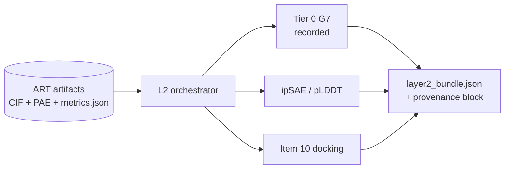

# handover.md — A2A coding task

| Field | Value |
|---|---|
| **Task** | `refactor` / subtype `upgrade` |
| **Assignee** | z.ai **GLM-5.3** (coding) |
| **System** | Agentic fleet — campaign `NYESO1-A0201` |
| **Handover author** | Cloud agent (spec + recommendations reconciliation) |
| **Date** | 2026-10-22 (UTC) |
| **Repository** | `wetware-hq/wing` — path `fleets/campaigns/NYESO1-A0201/` |
| **Advisory** | `recommendations.md` (fleet-truth reconciled; wet-lab items → `CASE.md`) |

---

## 1. What you are being asked to do

Upgrade and refactor the **pre-experimental geometric layer** for this campaign: the pure-CPU path that scores mirrored Boltz artifacts **after** layer 1, without touching hosted design spend, APPR, or `FLEET.toml` gating descriptors.

The authoritative methods document is **`UPGRADES.md` (v1.0, 2026-10-22)**. Your job is to turn its **Tier 0 / Tier 1 / Tier 2** table into a coherent, test-backed execution surface on the existing layer-2 hosts (local box + optional Modal CPU), while respecting every **proposal vs applied** boundary in section 9.

**`recommendations.md`** adds fleet hygiene and scope boundaries (binder modality, specificity-first ranking, artifact naming). Implement only items cross-walked to code in §6 of that file; do not implement wet-lab assays in this task.

This is **not** a clinical or affinity task. No real patient data. All coordinates are synthetic campaign artifacts (`pres_*` under `run-one/artifacts/`).

---

## 2. Read order (do not skip)

1. **`UPGRADES.md`** — full file; section 2 (framework G1–G7), section 4 (heuristic table), section 5 (rejections), section 9 (Tier 0 measurements P1–P4).
2. **`recommendations.md`** — §0 fleet truth, §3 in-silico assay ladder, §5 hygiene, §6 mapping to work packages below.
3. **`FLEET.toml`** — graph nodes `ART` → `L2` → `DIV`; `primary_endpoint = specificity_margin`; `[run_one.descriptors]` gating; `[platform.modal_layer2]`; spend/APPR invariants.
4. **`infra.json`** — `layer2_execution_pin`, `layer_2_modal_cpu_host`, content-address pins (ghcr digest + bindi wheel).
5. **`PLATFORM.md`** — hosted API vs CPU-only self-host (item 10 docking is CPU-only and in scope).
6. **`CASE.md`** — specificity not affinity; downstream SPR/tetramer/Jurkat (**out of scope for coding WP**).
7. **Existing code**
   - `run-one/contact_analysis.py` + `CONTACTS.md` (docking site, campaign-specific rule).
   - `run-one/tier0_targeting.py` (+ `sweep` subcommand) — BindCraft2 G7 metrics, **recorded only**.
   - `run-one/layer2_eval.py` — ipSAE driver used for run one.
   - `modal_layer2_app.py` — Modal CPU host for ipSAE (live app; do not deploy or spend without APPR).
8. **`targeting_flags.json`** — residue flags; note `_coldspot_ambiguity` and `epitope_shell_cutoff_angstrom: 10.0`.

**Do not open** held-out answer folders or write scenario/wording answer files (repo `AGENTS.md`).

**Do not implement** from superseded draft assumptions: 1G4 TCR primary-cell engineering, dual peptide SLLMWITQL triage, or wet-lab runs referenced only in external drafts — none exist in this repo (`recommendations.md` §0).

---

## 3. Current state (as of handover)

| Area | Status |
|---|---|
| Run one | **Complete** — job `prot_des_TY6KzyxULq8mACflXbhn`, 10 designs, `$0.50`, artifacts under `run-one/artifacts/`, G1–G4 pass (`FLEET.toml` `[run_one.result]`). |
| Specificity margin | **Not computed** — no L1B decoy refold in run one (`FLEET.toml` `[run_one]` caveat). |
| Layer 2 ipSAE | **Wired** — `layer2_eval.py` + `layer2_results.json`; gating **`iptm` and `plddt` only**. |
| Tier 0 G7 metrics | **Implemented** — `tier0_targeting.py` → `tier0_targeting_results.json`; tests in `tests/test_tier0_targeting.py`. |
| Shell sweep (item 1) | **Done** — proves 10 Å shell vacuous (F1). |
| HECTOR G1/G3 retrieval | **Rejected** (groove geometry). |
| Post-hoc `Sc` gate | **Rejected**; no `sc_results.json`. |
| **Item 10** docking | **Not implemented** — Tier 2 priority (`UPGRADES.md` §4). |
| L2 integration | **Fragmented** — violates `recommendations.md` §3.7; unify in WP-A. |

### Applied proposals (UPGRADES.md text — code may lag)

| ID | Decision | In code today |
|---|---|---|
| **P1** | Item 1 at **5.0 Å** shell for *reporting*; RECORDED-NON-GATING through run two | `targeting_flags.json` still **10.0 Å**; tier0 JSON `parameters` still **10.0 Å**. |
| **P2** | Item 3 GATING at zero buried-anchor contacts | §4 only — not `FLEET.toml`; tier0 must not threshold. |
| **P3** | §6 operational line | Owner only. |
| **P4** | Explicit rim residue list | Blocked — helix-minus-shell documented. |

---

## 4. Goal architecture (refactor target)

Unify layer 2 under one **deterministic, conjunctive, recorded** pipeline (aligns with `recommendations.md` §3 tier 3):



**Principles (UPGRADES G5 / G6 + recommendations §2.4):**

- Conjunctive filters when enabled; no composite that buys off geometric failures with `iptm`.
- Item 10: non-Boltz rigid body; report **comparisons** only.
- Bundle records **parameters + pins** (`recommendations.md` §5.10).

---

## 5. Work packages (priority order)

### WP-A — Layer 2 orchestrator refactor (required)

One entrypoint (local CLI + shared core for Modal) per `artifacts/pres_*`:

1. ipSAE path unchanged in behaviour vs `layer2_results.json`.
2. Tier 0: keep **10.0 Å** for regression; add **5.0 Å** item-1 block labelled `reporting_shell_angstrom: 5.0` (P1).
3. Merged output e.g. `run-one/artifacts/layer2_bundle.json` with schema version field.

Constraints: no tier0 executable thresholds; no new `FLEET.toml` gating keys.

### WP-B — Optional buried-anchor policy (required)

`--policy buried-anchors-zero`: non-zero exit if any `item_3_buried_anchor_contact_count ≠ 0`; not fleet gating until sign-off (P2). All ten run-one designs expected at zero (F2).

### WP-C — Item 10 independent docking (required)

CPU-only rigid-body re-derivation; pose agreement + complementarity **delta**; not affinity evidence (`UPGRADES.md` item 10).

### WP-D — Conjunctive policy skeleton (nice-to-have)

`run-one/l2_policy.py`: `{criterion_id: pass|fail|skipped}` for items 3, 5, 6; default skipped except WP-B when flagged.

### WP-E — Documentation sync (required, small)

`infra.json` / `arch.mermaid` L2 label only if entrypoints change. Do not duplicate `UPGRADES.md` §8 index.

### WP-F — Fleet hygiene in bundle metadata (required, from recommendations §5)

Each design record in the L2 bundle must include:

- `design_id` = directory name (`pres_*`)
- `job_id` when known (run one: `prot_des_TY6KzyxULq8mACflXbhn`)
- Relative artifact paths (`_predicted.cif`, `metrics.json`, `pae.npz`)
- `provenance`: ghcr digest, bindi wheel sha256, `targeting_flags` content hash or path
- Optional `display_alias`: `NYESO1-<design_id>` only as metadata (§5.8)

Do **not** rename artifact directories.

---

## 6. Explicit non-goals

| Do not | Reason |
|---|---|
| Change `FLEET.toml` gating (`iptm`, `plddt`) | UPGRADES + tests |
| Spend / submit Boltz / `modal deploy` without APPR | Governance |
| Port HECTOR G1/G3 | G1 inapplicable |
| Absolute `Sc` / HECTOR gates on predicted coords | UPGRADES §5 |
| Fit shell cutoff to run-one spread | F1 sweep warning |
| Edit UPGRADES §6 prediction (P3) | Owner |
| Implement SPR, tetramer, cytotoxicity, CRS panels | `CASE.md` / BIO Physician |
| TCR affinity maturation, 1G4 lineage, SLLMWITQL dual-epitope wet lab | Not this campaign (`recommendations.md` §0) |

---

## 7. Acceptance criteria

1. `python3 -m pytest -q` exits **0** (includes `tests/test_tier0_targeting.py`, `tests/test_contact_analysis.py`).
2. L2 orchestrator reproduces ipSAE fields consistent with `layer2_results.json` (additive keys allowed).
3. Tier 0: all ten designs `item_3_buried_anchor_contact_count == 0`; dual shell documented if added.
4. Item 10 artifact for all ten designs (pose agreement + complementarity change).
5. No tier0 metric thresholds in executable AST.
6. `FLEET.toml` gating and APPR blocks unchanged unless user requests otherwise.
7. `layer2_bundle.json` includes WP-F provenance block for every design.

---

## 8. Verification commands

```bash
cd /workspace
python3 -m pytest -q tests/test_tier0_targeting.py tests/test_contact_analysis.py

python3 fleets/campaigns/NYESO1-A0201/run-one/tier0_targeting.py \
  --artifacts fleets/campaigns/NYESO1-A0201/run-one/artifacts

python3 -c "import ast; ast.parse(open('fleets/campaigns/NYESO1-A0201/modal_layer2_app.py').read())"
```

---

## 9. Content-address pins (do not drift)

| Pin | Value |
|---|---|
| Layer-2 base image | `ghcr.io/wetware-hq/bindi-fleet-env@sha256:7e8762aebc3390611aafe0b67d925e567199d519e638113a80da33b86246a8e6` |
| Worker wheel | `bindi-0.2.0-py3-none-any.whl`, sha256 `6554960c1864ee3aabb64eccc7f639a78613daf2bb28b966abc27da1cb7d4e42`, commit `70b6c6c` |
| Binder chain id | `D` |
| Contact cutoff | 4.0 Å heavy-atom (G7) |
| Run-one job id | `prot_des_TY6KzyxULq8mACflXbhn` |

---

## 10. Open decisions (do not resolve unilaterally)

| ID | Question | Owner |
|---|---|---|
| P1 | 5.0 Å reporting + `targeting_flags.json` | Mathew |
| P2 | Item 3 → `FLEET.toml` gate | Mathew |
| P3 | UPGRADES §6 operational line | User |
| P4 | Rim residue list | User + BIO Physician |
| — | Items 5, 7, 8, 10 as fleet gates | User |
| OD-2 | Negative-design panel in request | Mathew + BIO Physician |
| OD-3 | Decoy peptide sequences (blocks specificity margin) | BIO Physician |
| OD-5 | In-vitro bar (multimer vs cytotoxicity) | BIO Physician |

---

## 11. Deliverables checklist for GLM-5.3

- [ ] WP-A unified L2 orchestrator (local + Modal-shared core)
- [ ] WP-A dual shell 5.0 Å + 10.0 Å reporting
- [ ] WP-B optional `--policy buried-anchors-zero`
- [ ] WP-C item 10 docking + results JSON
- [ ] WP-F provenance metadata in bundle
- [ ] Tests green; branch `cursor/*-2a3a`

---

## 12. Return protocol

Post A2A **Task** artifact with:

1. Entrypoints and JSON paths (including `layer2_bundle.json`).
2. Diff stat + test output.
3. Unchanged governance files listed explicitly.
4. Item 10 blockers if any.
5. Note which `recommendations.md` items were implemented vs deferred to Physician.

---

*End of handover.*
