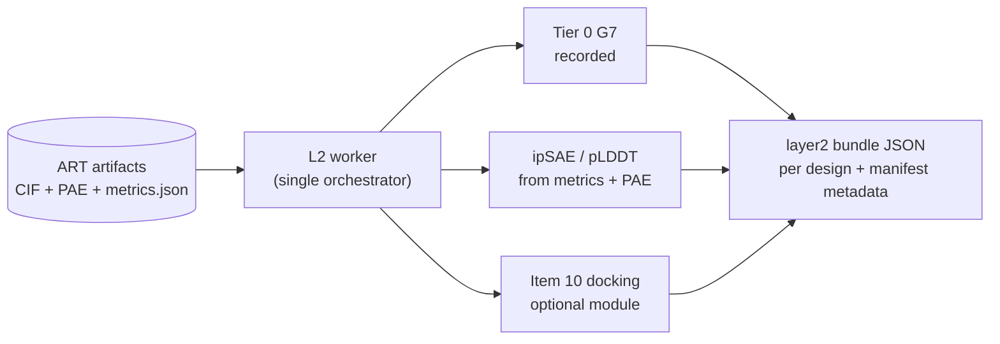

# handover.md — A2A coding task

| Field | Value |
|---|---|
| **Task** | `refactor` / subtype `upgrade` |
| **Assignee** | z.ai **GLM-5.3** (coding) |
| **System** | Agentic fleet — campaign `NYESO1-A0201` |
| **Handover author** | Cloud agent (spec review only; no layer-2 code changes in this turn) |
| **Date** | 2026-10-22 (UTC) |
| **Repository** | `wetware-hq/wing` — path `fleets/campaigns/NYESO1-A0201/` |

---

## 1. What you are being asked to do

Upgrade and refactor the **pre-experimental geometric layer** for this campaign: the pure-CPU path that scores mirrored Boltz artifacts **after** layer 1, without touching hosted design spend, APPR, or `FLEET.toml` gating descriptors.

The authoritative methods document is **`UPGRADES.md` (v1.0, 2026-10-22)**. Your job is to turn its **Tier 0 / Tier 1 / Tier 2** table into a coherent, test-backed execution surface on the existing layer-2 hosts (local box + optional Modal CPU), while respecting every **proposal vs applied** boundary in section 9.

This is **not** a clinical or affinity task. No real patient data. All coordinates are synthetic campaign artifacts (`pres_*` under `run-one/artifacts/`).

---

## 2. Read order (do not skip)

1. **`UPGRADES.md`** — full file; section 2 (framework G1–G7), section 4 (heuristic table), section 5 (rejections), section 9 (Tier 0 measurements P1–P4).
2. **`FLEET.toml`** — graph nodes `ART` → `L2` → `DIV`; `[run_one.descriptors]` gating; `[platform.modal_layer2]`; spend/APPR invariants.
3. **`infra.json`** — `layer2_execution_pin`, `layer_2_modal_cpu_host`, content-address pins (ghcr digest + bindi wheel).
4. **`PLATFORM.md`** — what may run on hosted API vs CPU-only self-host (item 10 docking is CPU-only and in scope).
5. **`CASE.md`** — why **specificity**, not affinity, is the product (MAGE-A3/titin record must stay in prose).
6. **Existing code**
   - `run-one/contact_analysis.py` + `CONTACTS.md` (docking site, campaign-specific rule).
   - `run-one/tier0_targeting.py` (+ `sweep` subcommand) — BindCraft2 G7 metrics, **recorded only**.
   - `run-one/layer2_eval.py` — ipSAE driver used for run one.
   - `modal_layer2_app.py` — Modal CPU host for ipSAE (live app; do not deploy or spend without APPR).
7. **`targeting_flags.json`** — residue flags; note `_coldspot_ambiguity` and `epitope_shell_cutoff_angstrom: 10.0`.

**Do not open** held-out answer folders or write scenario/wording answer files (repo `AGENTS.md`).

---

## 3. Current state (as of handover)

| Area | Status |
|---|---|
| Run one | **Complete** — 10 designs, artifacts mirrored under `run-one/artifacts/`, machine gates G1–G4 pass (`FLEET.toml` `[run_one.result]`). |
| Layer 2 ipSAE | **Wired** — `layer2_eval.py` + `layer2_results.json`; gating descriptors **`iptm` and `plddt` only**. |
| Tier 0 G7 metrics | **Implemented** — `tier0_targeting.py` → `tier0_targeting_results.json`; tests in `tests/test_tier0_targeting.py`. |
| Shell sweep (item 1) | **Done** — `tier0_targeting.py sweep` → `shell_sweep_results.json`; proves 10 Å shell is vacuous (F1). |
| HECTOR G1/G3 retrieval | **Rejected** for this target (groove geometry); do not port `hector_mapper` fingerprinting. |
| Post-hoc Lawrence–Colman `Sc` gate | **Rejected**; no `sc_results.json` (never existed — do not add a gate on absolute `Sc`). |
| **Item 10** (independent rigid-body docking) | **Not implemented** — highest-value Tier 2 upgrade in `UPGRADES.md` §4. |
| L2 integration | **Fragmented** — ipSAE, Tier 0, and contact analysis are separate entrypoints; fleet graph shows one `L2` node. |

### Applied proposals (already in `UPGRADES.md` text — code may lag)

| ID | Decision | In code today |
|---|---|---|
| **P1** | Item 1 re-registered at **5.0 Å** shell for *reporting*; **RECORDED-NON-GATING** through run two | `targeting_flags.json` still **10.0 Å** (intentional: moving it shifts coldspot rim — F4). Tier 0 JSON still records **10.0 Å** in `parameters`. |
| **P2** | Item 3 **GATING at exactly zero** buried-anchor contacts | Documented in `UPGRADES.md` §4 only — **not** in `FLEET.toml`; tier0 module must **not** threshold per `tests/test_tier0_targeting.py`. |
| **P3** | Fix section 6 operational line vs falsification | **Owner only** — do not edit pre-registered prediction without user sign-off. |
| **P4** | Explicit α1/α2 rim residue list | **Blocked** — keep helix-minus-shell derivation explicit. |

---

## 4. Goal architecture (refactor target)

Unify layer 2 under one **deterministic, conjunctive, recorded** pipeline:



**Principles (from UPGRADES G5 / G6):**

- **Hard conjunctive filters** when gating is eventually enabled: each criterion passes or fails on its own; no weighted composite that lets a good `iptm` pay for a geometric violation.
- **Epistemic ordering**: scores on **predicted** coordinates are not independent evidence; item 10 must use a **non-Boltz** rigid-body method and report **comparisons** (pose agreement, complementarity *change*), never an absolute docking affinity.
- **Record parameters beside numbers** (shell cutoff, contact cutoff, flags hash).

---

## 5. Work packages (priority order)

### WP-A — Layer 2 orchestrator refactor (required)

**Objective:** One entrypoint (local CLI + callable from Modal) that, per design id under `artifacts/pres_*`:

1. Reuses existing ipSAE path (`bindi.ipsae` / current `layer2_eval.py` logic).
2. Invokes Tier 0 metrics (`tier0_targeting.measure_design` or equivalent) with **explicit** shell reporting:
   - Keep **10.0 Å** run aligned with `targeting_flags.json` for regression tests.
   - Add **parallel 5.0 Å** item-1 block per P1 (clearly labelled `reporting_shell_angstrom: 5.0`, not silently replacing 10.0).
3. Emits one merged JSON (e.g. `run-one/artifacts/layer2_bundle.json` or extend `layer2_results.json` with a version field).

**Constraints:**

- Do **not** add pass/fail gates inside tier0 executable code (`test_no_threshold_leaks_into_the_tier0_layer`).
- Do **not** add new gating keys to `FLEET.toml` without owner decision (`test_fleet_toml_gating_descriptors_are_untouched_by_this_work`).

**Modal:** Extend `modal_layer2_app.py` to call the same orchestrator body as local (shared module under `run-one/` or `fleets/campaigns/NYESO1-A0201/`). Preserve pins: ghcr digest, `WORKER_WHEEL_SHA256`, `BINDER_CHAIN = "D"`, thread env vars.

### WP-B — Item 3 “zero buried anchors” as optional CLI policy (required)

**Objective:** Separate **policy** from **measurement**:

- Tier 0 continues to **record** `item_3_buried_anchor_contact_count`.
- Add an optional flag (e.g. `--policy buried-anchors-zero`) on the L2 orchestrator that exits non-zero if any design has count ≠ 0, with a clear stderr message citing UPGRADES item 3 / P2.
- Document that this is **not** `FLEET.toml` gating until Mathew signs per-SHA.

Run-one expectation: all ten designs already at zero (F2).

### WP-C — Item 10 independent docking (required, Tier 2)

**Objective:** Implement UPGRADES §4 item 10 on CPU only:

- Rigid-body re-derivation of binder pose against target using a library **not** shared with Boltz (e.g. Open Babel / RDKit / scipy rotation search — choose one, justify in module docstring).
- Outputs per design:
  - **Pose agreement** metric (e.g. RMSD after superposition) between designed and re-derived pose.
  - **Complementarity change** between designed vs re-derived pose (may use `shape_complementarity` in pinned image — report **delta**, not absolute gate).
- Status: complementarity **change** = RECORDED-NON-GATING; pose agreement may be wired as proposed gate only behind a flag, not `FLEET.toml`.

**Out of scope:** HECTOR SSIM maps, fingerprint retrieval, neural re-predictors on Modal GPU.

### WP-D — Conjunctive policy skeleton (nice-to-have)

Implement a small module (e.g. `run-one/l2_policy.py`) that takes recorded metrics and returns `{criterion_id: pass|fail|skipped}` for items 3, 5, 6 — **no thresholds** for items 1–2 until owner pre-registers. Default mode: all `skipped` except optional WP-B.

### WP-E — Documentation sync (required, small)

- Update `infra.json` only if pins or entrypoints change (keep `verified` discipline).
- If `arch.mermaid` L2 label still lists descriptors not produced in run one, align label with what L2 actually emits post-refactor.
- Do **not** duplicate `UPGRADES.md` section 8 file index in new docs; cite paths.

---

## 6. Explicit non-goals

| Do not | Reason |
|---|---|
| Change `FLEET.toml` gating descriptors (`iptm`, `plddt` only) | `UPGRADES.md` header + tests |
| Lower `spend_cap_usd`, remove APPR, or submit Boltz jobs | Governance |
| Port HECTOR G1/G3 retrieval | G1 **INAPPLICABLE** on groove target |
| Add absolute `Sc` or HECTOR R-factor gates on predicted coords | §5 rejections |
| Pick item-1 shell cutoff by maximizing spread on run-one ten designs | §9 F1 / sweep `warning` |
| Edit section 6 pre-registered prediction (P3) | Owner-only |
| Commit bindi wheel to git unless repo policy changes | `modal_layer2_app.py` local wheel guard |
| `modal deploy` / paid API calls | Behind APPR |

---

## 7. Acceptance criteria

1. `python3 -m pytest -q` exits **0** in repo root (includes `tests/test_tier0_targeting.py`, `tests/test_contact_analysis.py`).
2. Re-running the L2 orchestrator on `run-one/artifacts/` reproduces ipSAE fields consistent with `layer2_results.json` (allow additive JSON keys).
3. Tier 0: all ten designs still show `item_3_buried_anchor_contact_count == 0`; parameters document both shell cutoffs if dual reporting is added.
4. Item 10: produces a new results artifact with pose agreement + complementarity change for all ten designs, with module doc stating it is **not** affinity evidence.
5. No new threshold comparisons on Tier 0 metrics inside `tier0_targeting.py` executable AST.
6. `FLEET.toml` unchanged in `[run_one.descriptors]` gating and APPR/spend blocks unless the user explicitly requests otherwise in a follow-up task.

---

## 8. Verification commands

```bash
cd /workspace
python3 -m pytest -q tests/test_tier0_targeting.py tests/test_contact_analysis.py

# Tier 0 (existing)
python3 fleets/campaigns/NYESO1-A0201/run-one/tier0_targeting.py \
  --artifacts fleets/campaigns/NYESO1-A0201/run-one/artifacts

# Layer 2 local (today — replace with unified orchestrator when WP-A lands)
# See FLEET.toml [run_one.result.layer2] for podman invocation pattern.

# Modal (local import check only — do not deploy without APPR)
python3 -c "import ast; ast.parse(open('fleets/campaigns/NYESO1-A0201/modal_layer2_app.py').read())"
```

---

## 9. Content-address pins (do not drift)

| Pin | Value |
|---|---|
| Layer-2 base image | `ghcr.io/wetware-hq/bindi-fleet-env@sha256:7e8762aebc3390611aafe0b67d925e567199d519e638113a80da33b86246a8e6` |
| Worker wheel | `bindi-0.2.0-py3-none-any.whl`, sha256 `6554960c1864ee3aabb64eccc7f639a78613daf2bb28b966abc27da1cb7d4e42`, commit `70b6c6c` |
| Binder chain id | `D` (verified on all run-one CIFs) |
| Contact cutoff | 4.0 Å heavy-atom (G7) |

---

## 10. Open decisions (do not resolve unilaterally)

| ID | Question | Owner |
|---|---|---|
| P1 | Per-SHA sign-off on 5.0 Å reporting + whether to change `targeting_flags.json` | Mathew |
| P2 | Promote item 3 policy to `FLEET.toml` gate | Mathew |
| P3 | Restate §6 operational correlation line | User (pre-registered) |
| P4 | Literature-based rim residue list | User + BIO Physician |
| — | Items 5, 7, 8, 10 as fleet gates | User |
| OD-2 | Negative-design panel in request body | Mathew + BIO Physician |
| OD-3 | Decoy peptide sequences | BIO Physician |

---

## 11. Deliverables checklist for GLM-5.3

- [ ] Unified L2 orchestrator (local + Modal-shared core)
- [ ] Dual shell reporting for item 1 (5.0 Å + 10.0 Å) without breaking tests
- [ ] Optional `--policy buried-anchors-zero` (non-FLEET gate)
- [ ] Item 10 docking module + results JSON
- [ ] Tests for new behavior; full `pytest -q` green
- [ ] Short commit message(s); no push to remotes other than `origin` on branch `cursor/*-2a3a`

---

## 12. Return protocol

When complete, post an A2A **Task** artifact containing:

1. Summary of refactored entrypoints and new JSON paths.
2. Diff stat and test command output.
3. Explicit list of **unchanged** governance files (`FLEET.toml` gating, APPR).
4. Any blockers on item 10 (dependency choice, runtime on Modal).

---

*End of handover.*
